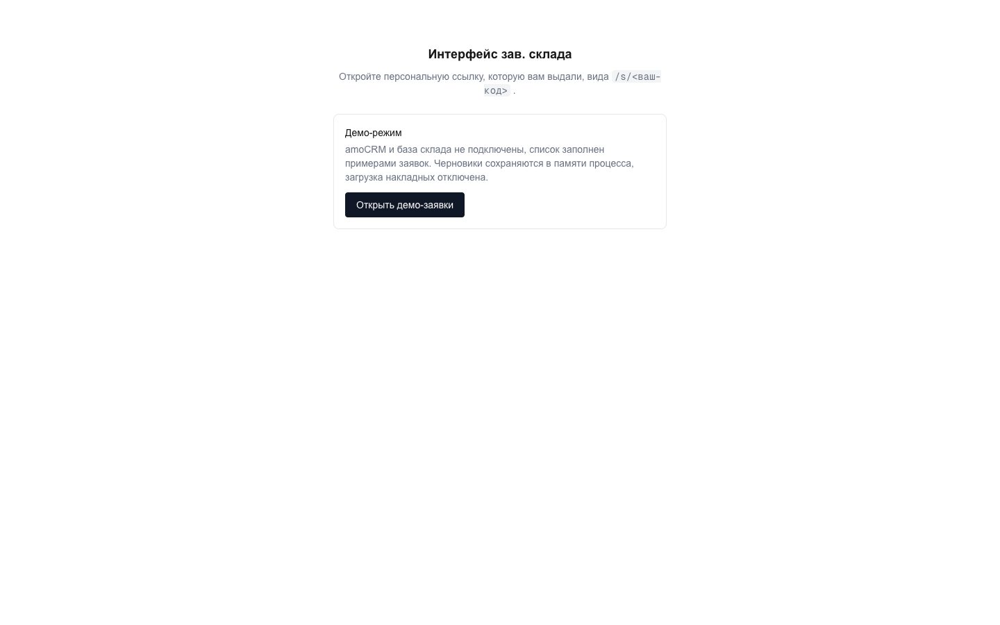
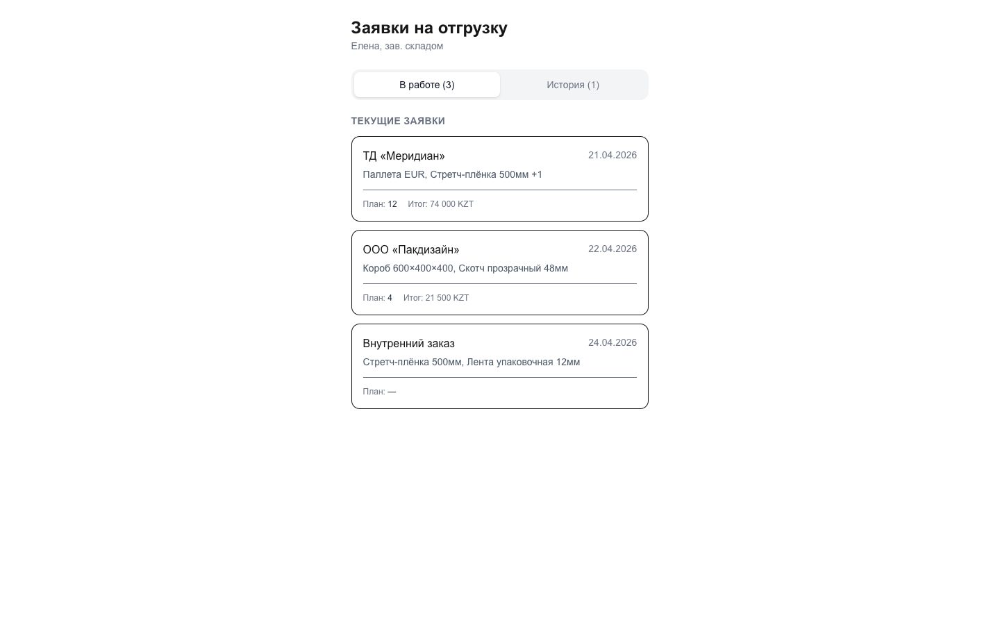
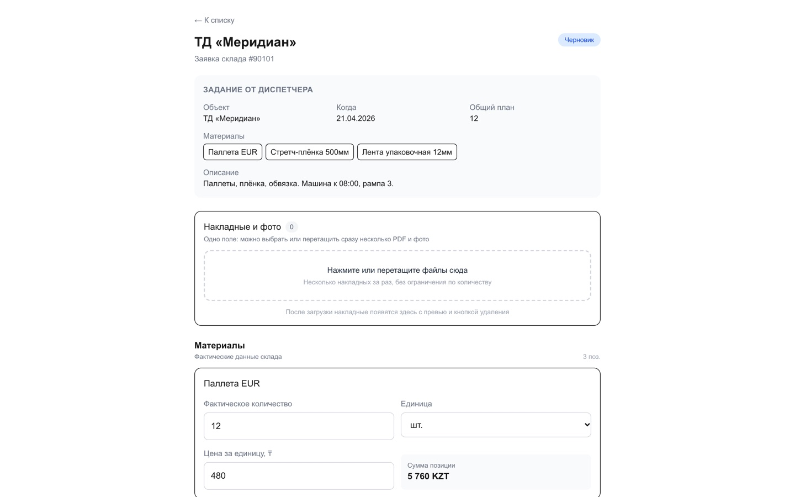
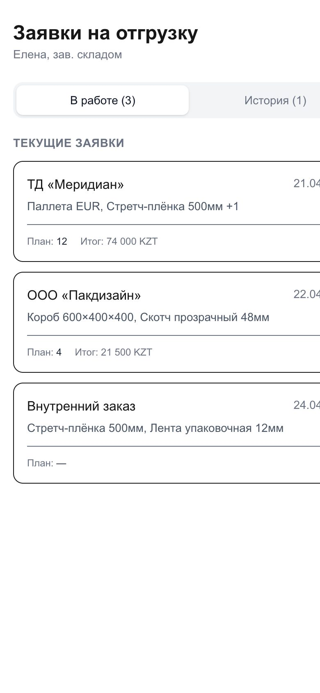

<div align="center">

# 4snab — интерфейс заведующего складом поверх amoCRM

**Не ещё одна CRM, а рабочее место одного человека внутри чужой CRM.**
Диспетчер переводит сделку на «Отгрузку» → склад получает связанную сделку → зав.
складом заполняет факт, единицу и закупочную цену отдельно по каждому материалу →
данные и накладные возвращаются в исходную сделку.

**Демо без amoCRM:** <https://4snab.vercel.app> → «Открыть демо-заявки» или `/s/demo-4snab`


</div>

---

<table>
  <tr>
    <td width="50%"></td>
    <td width="50%"></td>
  </tr>
  <tr>
    <td></td>
    <td align="center"></td>
  </tr>
</table>

## Задача

Склад в малой производственной компании живёт в таблице Excel, а сделки — в amoCRM,
и никто их не соединяет. Диспетчер теряет час на переписку «сколько фактически
ушло», зав. складом заполняет бумажную накладную, а себестоимость отгрузки
всплывает через месяц.

Готовые решения здесь не работают: складу не нужен весь CRM-интерфейс, а CRM не
нужна складская логика. Поэтому сделан тонкий слой — одна страница на человека с
именным токеном, которая живёт ровно в одном переходе воронки.

## Что это (и чего это не)

**Это интерфейс одного рабочего места, а не панель управления.** У зав. склада нет
логина и пароля: `src/lib/auth.ts` выдаёт каждому именную ссылку вида `/s/<токен>`
из переменной `WAREHOUSE_USERS`. Открыл закладку — работает.

**Это не дубль CRM.** AmoCRM остаётся источником сделок, воронок и этапов. SQLite
хранит только то, чего в amoCRM нет: построчные складские данные и черновики.

**Демо-режим — это не заглушка, а второй режим работы того же кода.** Пока
`WAREHOUSE_USERS` не задан, `src/lib/demoStore.ts` отдаёт четыре примера заявок
(три в работе, одна в истории), авторизует токен `demo-4snab`, а черновик и
завершение считают суммы в памяти процесса.

## Карта

```
 amoCRM (диспетчер)                    4snab                          amoCRM (склад)
 ┌──────────────────────┐   webhook   ┌──────────────────────────┐   ┌──────────────────┐
 │ сделка → «Отгрузка»  │ ──────────► │ /api/amo-webhook?secret= │   │ воронка «Склад»  │
 └──────────────────────┘             └─────────────────────────┘   └────────┬─────────
                                                   │ создаёт связанную сделку │
                              ┌────────────────────▼──────────────────┐       │
                              │ /s/<token>       интерфейс зав. склада │       │
                              │  · материал → факт · единица · цена    │       │
                              │  · общие поддоны · доставка            │       │
                              │  · N накладных (Files API, chunked)    │       │
                              │  · черновик → SQLite                   │       │
                              └────────────────────┬──────────────────┘       │
                                                   │ «Завершить»              │
   сделка диспетчера → «Получение накладной» ◄────────────────────────────── → «Готово»
```

## Что делает этот код необычным

- **Расчёт на `decimal.js`, а не на `Number`.** Факт, единица и закупочная цена
  считаются построчно и складываются в итог; float здесь даёт копеечный разрыв
  между накладной и тем, что видит диспетчер.
- **Несколько материалов в одной заявке — это основной путь, а не крайний случай.**
  Всё поле `Материал / Номенклатура` читается как список позиций. При этом для
  одной позиции заполняются существующие скалярные поля amoCRM (факт и цена), а для
  нескольких — намеренно нет: построчные значения живут в SQLite, и писать их в
  скалярное поле означало бы соврать в отчёте.
- **Накладные грузятся через Files API с частичной загрузкой** — без ограничения на
  число файлов и без лимита на размер тела запроса, который ломает обычный
  `multipart` на проде.
- **Дедупликация вебхука тегом.** После создания складской сделки исходная помечается
  `AMOCRM_PROCESSED_TAG`; повторный вебхук ничего не создаёт. ID исходной сделки
  пишется в поле `AMOCRM_FIELD_SOURCE_LEAD`, так что связь двусторонняя.
- **Черновик не трогает CRM.** Сохранение — только SQLite. В amoCRM уходит один
  финальный запрос, когда зав. склада нажал «Завершить».
- **`npm run discover` вместо ручного выуживания ID.** Воронки, этапы и кастомные
  поля amoCRM идентифицируются числами; скрипт печатает их, а `scripts/create-fields.mjs`
  создаёт недостающие идемпотентно.

## Карта фич

| Слой | Файл | Что делает |
|---|---|---|
| Клиент CRM | `src/lib/amocrm.ts` | API v4 на долгосрочном токене, только сервер |
| Вебхук | `src/app/api/amo-webhook/route.ts` | приём «смена этапа», фильтр по воронке и этапу, секрет в query |
| Домен | `src/lib/requests.ts` | сделка ⇄ заявка на отгрузку, единственная точка перевода |
| Расчёты | `src/lib/warehouse-calculations.ts` | построчные и итоговые суммы на `decimal.js` |
| Хранилище | `src/lib/warehouse-db.ts` | SQLite, миграции, версии, черновики |
| Доступ | `src/lib/auth.ts` | именные токены из `WAREHOUSE_USERS` |
| API заявок | `src/app/api/requests/`, `.../[id]/files/` | список и карточка по токену, частичная загрузка накладных |
| Демо | `src/lib/demoStore.ts` | четыре заявки и in-memory расчёт без CRM и без БД |

## Стек и размер

| 4 864 | 30 | 3 | 6 | 2 |
| --- | --- | --- | --- | --- |
| строк TS/TSX | файлов | страницы | API-роута | тестовых файла (vitest) |

Next.js 16 (App Router), TypeScript, Tailwind. `better-sqlite3` для черновиков и
построчных данных, `decimal.js` для денег, `amoCRM API v4` + Files API. Долгосрочный
токен живёт только в переменных окружения на сервере и ни в одном клиентском бандле.

## Запуск

```bash
npm install
cp .env.local.example .env.local   # AMOCRM_SUBDOMAIN, AMOCRM_ACCESS_TOKEN
npm run discover                   # ID воронок / этапов / полей → в .env.local
npm run dev
```

Открыть `http://localhost:3000/s/<токен из WAREHOUSE_USERS>`. Без `WAREHOUSE_USERS`
приложение само становится витриной с демо-заявками.

Проверки перед выкаткой:

```bash
npm test && npm run lint && npx tsc --noEmit && npm run build
```

Для загрузки накладных у интеграции amoCRM должен быть включён scope
**«Доступ к файлам»**; scope удаления не требуется и не запрашивается.

## Известные ограничения

- **SQLite рассчитана на один постоянный локальный сервер.** Перед переносом на
  Vercel или на несколько экземпляров базу нужно перевести в PostgreSQL — это
  осознанный долг, а не случайность.
- **В демо не работает загрузка накладных** (нужен Files API), синхронизация с
  воронкой склада и персистентность: серверная функция живёт до выгрузки контейнера.
- **Не сделано:** уведомление зав. складу о новой заявке (Wazzup), отчёт
  «Табель отгрузки» в Excel с прибылью по отгрузке, несколько рейсов в одной заявке.
- **Вебхук принимает только один переход** — на этап `AMOCRM_DISPATCH_SHIPPING_STATUS_ID`
  в воронке `AMOCRM_DISPATCH_PIPELINE_ID`. Всё остальное игнорируется молча.

## Права

© 2026 Nikita Koreshkov. Портфельная работа, все права защищены. AmoCRM, названия
воронок и данные клиента принадлежат их владельцам; интеграция использует открытое
API amoCRM.
